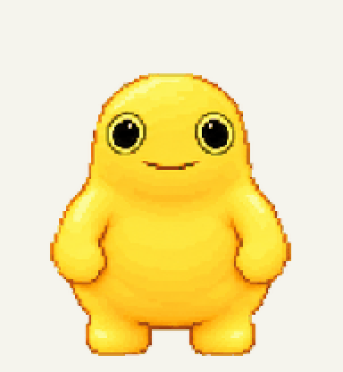
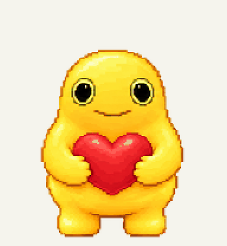
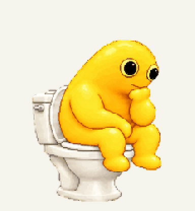

# 小奶蛙 · Milk Frog Pet

一只呆呆的黄色像素奶蛙，平时空手站着，碰到光标会抱心，工作时坐在马桶上思考。

适用于支持 v2 自定义宠物的 ChatGPT / Codex 桌面客户端。已在 macOS 本机安装和账号宠物中验证素材；不同客户端的安装入口、状态触发和播放次数可能不同。



## 下载与安装

从 [最新 Release](https://github.com/hanyujason/milk-frog-pet/releases/latest) 下载 **milk-frog-pet-macos.zip**，解压整个文件夹。

### macOS 本地安装

1. 双击 `安装小奶蛙.command`。如果系统要求确认，请先查看脚本内容，再按系统提示打开。
2. 打开客户端的 **设置 → Pets → 刷新**，选择 **小奶蛙**。
3. 若没有显示桌面宠物，在客户端输入 `/pet`，或选择 **Show pet**。

安装器将素材放到 `~/.codex/pets/milk-frog/`；设置过 `CODEX_HOME` 时会使用该目录。脚本不需要管理员权限。已安装相同版本时会直接退出；更新已有同名本地宠物前会备份到 `~/.codex/pet-backups/`。

也可以在终端进入解压目录后执行：

```sh
zsh ./安装小奶蛙.command
```

### 账号里的宠物

如果客户端提供自定义宠物的上传或编辑入口，可选择 `milk-frog/spritesheet.png`。图片为 **1536 × 2288 的 v2 扩展格式**，需要对应格式支持。

**本地安装不会更新已经同步到账号的旧宠物。** 若旧宠物仍在跳跃，请在账号宠物的编辑入口更新图片，或重新选择本地安装的版本。

部分网页上传入口只接受 1536 × 1872 的旧格式，本包不适用于该入口。不要直接缩放图片，缩放会破坏动作布局。Pets 的入口说明见 [OpenAI 官方文档](https://learn.chatgpt.com/docs/pets)。

## 动作

| 状态 | 小奶蛙的表现 |
| --- | --- |
| 待机 | 双手在身侧，空手呆站，轻微呼吸 |
| 光标碰到宠物 | 抱出红色爱心，替代原生跳跃画面 |
| 等待输入 | 抱心等待 |
| 工作中 | 坐在马桶上，托腮思考 |
| 移动 | 左右跑动 |
| 其他状态 | 挥手、受挫、查看结果 |
| 看向光标 | 16 个注视方向 |

| 待机 | 悬停抱心 | 马桶思考 |
| :---: | :---: | :---: |
|  |  |  |

## 当前效果与限制

- 动作触发由原生客户端控制。本素材将 `jumping` 槽替换为抱心，因此调用这个槽的其他交互也可能显示抱心。
- 在已测试的原生客户端中，悬停动作会播放三轮后恢复待机。**尚不支持一直抱心直到光标移走。** GIF 预览循环播放不代表客户端会无限循环。
- 原生安装版提供坐在马桶上思考的循环帧；不包含早期交互演示中的完整“马桶从地面冒出再坐上去”转场。
- 系统开启减少动态效果时，客户端可能只显示静态帧。
- 本安装器仅针对 macOS；Windows 未测试。素材包不修改客户端程序。

## 素材规格

透明 RGBA PNG，1536 × 2288，8 列 × 11 行，每格 192 × 208。包含 9 组动作、16 个注视方向，共 73 个有效画面。布局见 [FORMAT.md](FORMAT.md)。

本发布版本的 `spritesheet.png` SHA-256：

```text
dde4e035d5a2cd78b4937490677c4ff20ee406326462c811d049bd879475462c
```

发布前已核对图片格式、透明度、有效帧布局、文件校验和，以及全新安装、重复安装和备份更新行为。图片与当前已验证的账号版本逐像素一致。

## 制作说明

根据提供的奶蛙参考图进行 AI 辅助像素化、动作设计和逐帧整理。参考来源与授权说明见 [ATTRIBUTION.md](ATTRIBUTION.md)。这是个人制作的宠物素材项目，与 OpenAI 无官方关联。
